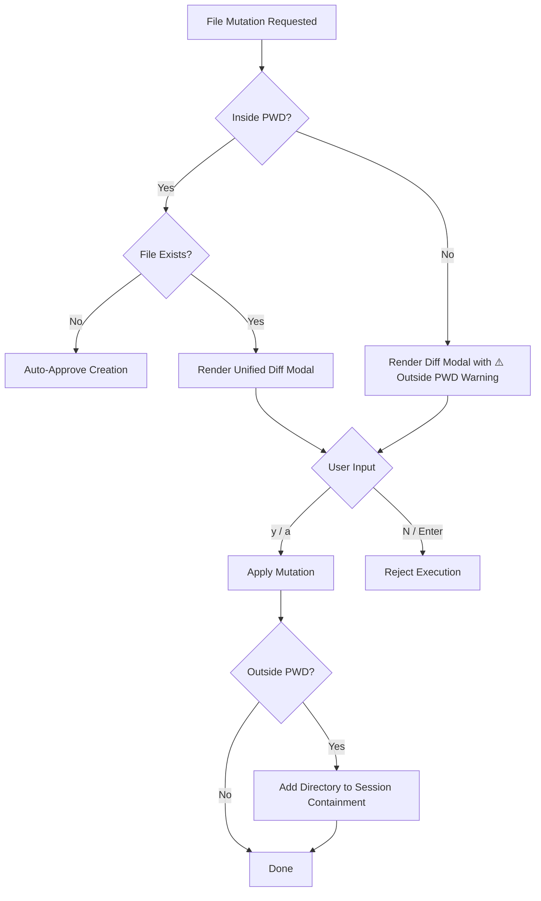
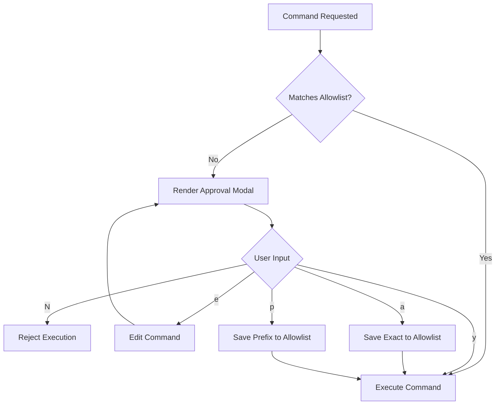
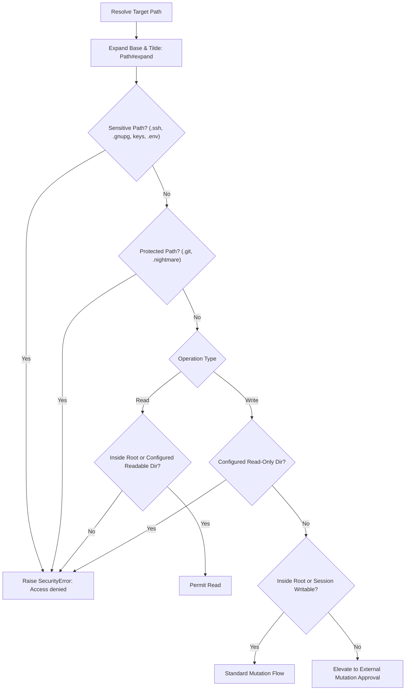

# Approval Boundary

Nightmare maximizes agent autonomy on read operations while enforcing explicit user control on state mutations. This prevents destructive actions while maintaining high velocity for reconnaissance and context gathering.

## File Mutation Approval

Nightmare distinguishes file mutations based on working directory containment (`pwd`):
- **Inside `pwd`**: Creating new files is automatically approved to accelerate bootstrapping. Modifying existing files presents an interactive unified diff for review before writing.
- **Outside `pwd`**: All mutations (both new files and existing modifications, such as writing to `~/.config/...` or sibling repositories) require interactive user approval. New files present a unified diff against an empty file, and the approval modal displays a prominent colored warning banner:
  ```text
  ⚠️  MUTATION OUTSIDE PWD (WORKING DIRECTORY)
  ```
- **Dynamic Containment**: Approving an external mutation automatically registers the parent directory into the session's writable and readable directories, allowing subsequent operations within that directory during the active session.



```crystal
# Approving a diff programmatically
approval = Nightmare::UI::Approval.new("/workspace")
approved = approval.approve_diff(diff_text, "overwrite src/main.cr")
```

| Option | Description |
|---|---|
| `y` / `a` | Approve the file mutation once. |
| `N` / `Enter` | Reject the file mutation (default). |

## Command Approval

Command execution requires explicit approval unless matched by an allowlist. The modal displays the command, arguments, working directory, and timeout, offering fine-grained persistence options.



| Option | Description |
|---|---|
| `y` | Approve execution once (do not save). |
| `N` | Reject execution (default). |
| `e` | Edit command inline and re-prompt for approval. |
| `a` | Save exact command to allowlist for auto-approval. |
| `p` | Save command prefix (binary + first subcommand) to allowlist. |

## The Allowlist System

The allowlist grants auto-approval to trusted commands. It supports exact matching and prefix matching (binary name or subcommand), scoped to either the current session or persisted globally.

```bash
# Persisted allowlist location (per-workspace)
cat ~/.config/nightmare/workspaces/<workspace-id>/allow
```

```text
# Example allowlist format
prefix:git status
prefix:ls
cat src/main.cr
^npm run build.*
```

| Scope | Type | Behavior |
|---|---|---|
| Session | Exact | Auto-approves exact command string for the lifetime of the process. |
| Session | Prefix | Auto-approves binary or binary+subcommand for the session. |
| Persist | Exact | Persists exact string to workspace `allow` file. |
| Persist | Prefix | Persists prefix (e.g. `prefix:git status`) globally. |

## Metacharacter and Flag Bans

Commands containing shell metacharacters or high-risk flags bypass the allowlist and mandate interactive approval. This prevents command injection and unauthorized subshells.

```crystal
# Commands with these characters will always prompt
Nightmare::Tools::Allowlist::METACHARACTERS = [
  ';', '&', '|', '`', '$', '>', '<', '\n', '\r', '(', ')', '{', '}',
  '\\', '*', '?', '[', ']', '~', '#', '!', '\0', '\e'
]
```

```bash
# This exact string will prompt even if 'echo' is in prefix allowlist
echo "Hello" > output.txt
```

### Denylisted Flags

Specific flags that execute code or manipulate configurations are permanently denylisted. 

| Flag / Pattern | Example | Reason |
|---|---|---|
| `-c`, `-e`, `-E`, `-C` | `bash -c "rm -rf /"` | Inline code execution. |
| `--config`, `--upload-pack`, `--receive-pack` | `git --upload-pack=...` | Configuration override / remote execution. |
| `-exec`, `-execdir`, `-ok`, `-okdir` | `find . -exec rm {} \;` | Sub-command execution via find. |

## Security Guard and Path Resolution

`Nightmare::Tools::Guard` and `Nightmare::Workspace::Environment` mediate all read and write operations. Path resolution canonically expands home directories (`~` and `~/...`), strictly blocks access to sensitive credentials and protected repository metadata, and routes external mutations to user approval.



```crystal
guard = Nightmare::Tools::Guard.new(env)
safe_path = guard.resolve_write("~/.config/systemd/user/mailrail.timer")
```

### Canonical Tilde Expansion

Paths beginning with `~` or `~/` are expanded relative to the operator's home directory (`$HOME`). This ensures that tools, plan runners (`/plan run`), and CLI flags (`--system-prompt`) resolve paths canonically, preventing agents from accidentally creating `<pwd>/~` workspace directories when configuring user services or dotfiles.

### Sensitive Paths & Repository Integrity

Access to sensitive patterns and protected metadata is unconditionally denied on both read and write:
- **Sensitive Paths**: Patterns matching `.ssh`, `.gnupg`, `id_rsa*`, `*.pem`, `.env*`, and credential patterns raise `SecurityError`.
- **Protected Paths**: `.git`, `.nightmare` (and any dot-nightmare sibling files) are permanently prohibited from write operations.
- **Read-Only Directories**: Directories configured via `--read-dir` / `readable_directories` remain strictly read-only.

---
- Previous: [Tools](04-tools.md)
- Next: [Context Engine](06-context-engine.md)
